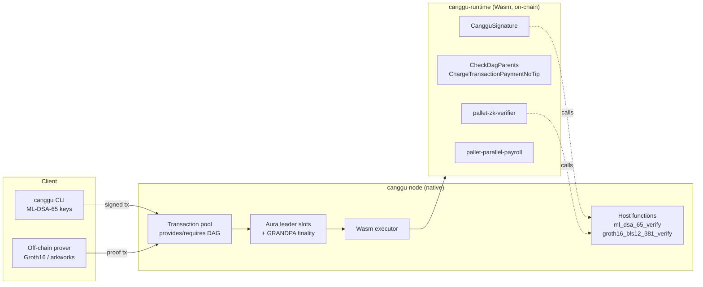

# Canggu on the Polkadot SDK

**How far can the Polkadot SDK be pushed?** This repository rebuilds *Canggu*, a quantum-secure,
MEV-resistant, GPU-parallel blockchain designed by the Bitwyre team, on top of the
[Polkadot SDK](https://github.com/paritytech/polkadot-sdk) (`polkadot-stable2609`).

It is an experiment, not an endorsement. The goal is to take an ambitious design and see which parts
map cleanly onto Substrate/FRAME, which need new primitives, and where the hard limits are,
including whether a Polkadot SDK node can put real work on a GPU.

> **Credits.** Canggu, its design and its original whitepaper are the work of
> **Dendi Suhubdy, Tejveer Singh, Mitul Dhawan and Maldini Sonkeng (Bitwyre)**. The original
> repository was set up by **Dendi Suhubdy** and **Mitul Dhawan** ([@mitul72](https://github.com/mitul72)),
> and its first commits are preserved in this repository's history. They open-sourced the project;
> this fork keeps their GPL-3.0 license. Everything built on top is an independent rebuild of their
> idea. Credit for the idea is theirs, and mistakes in the rebuild are ours.
>
> * Original whitepaper (v1.3): [`canggu-blockchain-whitepaper`](https://github.com/agustinustheo/canggu-blockchain-whitepaper)
> * Polkadot SDK edition of the whitepaper (v2.0), describing this code: [`v2/main.pdf`](https://github.com/agustinustheo/canggu-blockchain-whitepaper/blob/main/v2/main.pdf)

## What runs today

```
$ ./target/release/canggu demo
=== 1. Post-quantum accounts (ML-DSA-65 / CRYSTALS-Dilithium3) ===
  Alice -> Dave 100 CGU: 5345 byte extrinsic (1952-byte key + 3309-byte signature inside)
=== 2. DAG-ordered transactions (cross-account dependencies) ===
  submitting Charlie's tx FIRST; it declares Bob's tx (nonce 0) as parent
  2 blocks later the child is still not in any block: it waits for its parent
  parent: block #6 index 1 | child: block #6 index 2
=== 3. No priority auction: tips are rejected ===
  rejected by the pool as expected: Invalid Transaction: "Custom error: 0"
=== 4. Payroll: one debit, conflict-free parallel credits ===
  batch paying Bob twice: rejected with Payroll::DuplicateRecipient
=== 5. zk-SNARK: prove a private payroll off-chain, verify on-chain ===
  proof generated on CPU in 32.7ms: 192 bytes
  ok: the chain verified the payroll total without seeing any salary
  same proof, claimed total + 1: rejected with ZkVerifier::InvalidProof
All Canggu features exercised successfully.
```

| Canggu idea (v1.3) | How it maps onto the Polkadot SDK | Status |
| --- | --- | --- |
| Dilithium signatures | New `CangguSignature::MlDsa65` account signature, verified by a native **host function** | ✅ |
| Quantum-resistant hashing | BLAKE2b-256 already gives 128-bit post-quantum preimage security | ✅ |
| DAG mempool | The transaction pool is *already* a tag DAG. `CheckDagParents` adds cross-account edges, enforced by consensus | ✅ |
| MEV mitigation | Dependency enforcement + **no tips** (no priority-fee auction) | 🟡 encrypted mempool still needed |
| Tower-BFT-style leader consensus | Aura (2 s round-robin leader slots) + GRANDPA finality | ✅ (not sub-second) |
| ZK-SNARK verifiers / provers | Groth16 verifier pallet + host function; off-chain prover | ✅ (not post-quantum) |
| Parallel CPU/GPU contracts | Conflict-free batch payroll; GPU behind host functions | 🟡 GPU in progress |
| 50,000+ TPS | Measured: bandwidth-bound at ~370 PQ transfers/s | ❌ needs signature compression |

## Architecture



The core trick is to keep consensus logic in the Wasm runtime and move **heavy cryptography into
host functions**. A host function is a fixed bytes-in, bool-out contract that the node implements
natively. That is how Substrate verifies sr25519 today, and it is the one place where a node can
swap a CPU implementation for a GPU one without changing consensus.

## The pieces

### Post-quantum accounts: `primitives/`
* Accounts are `blake2_256(ml_dsa_public_key)`. A 1,952-byte key cannot be an `AccountId32`, so the
  signature carries the key and verification first checks that it hashes to the sender. This
  prevents key substitution and costs one hash.
* FIPS 204 context string `canggu/tx/v1` for domain separation, deterministic signing.
* Ed25519, Sr25519 and ECDSA stay as *transition-period* variants (same encoding indices as
  `MultiSignature`), so polkadot.js and subxt still work. A runtime upgrade can retire them.

### DAG-ordered transactions: `pallets/dag-ordering/`
* `CheckDagParents` lets a transaction declare up to 8 parents as `(account, nonce)`, including
  other accounts' transactions.
* Pending parents become `requires` tags with the exact encoding `frame_system::CheckNonce` uses
  for `provides`, so Substrate's existing ready/future queues do the topological ordering.
* The same check runs again when the block executes. A block that puts a child before its parent is
  **invalid**. The check runs *before* `CheckNonce`, so a rejected transaction mutates nothing.
* `ChargeTransactionPaymentNoTip` is the stock fee extension with tips rejected. Priority can no
  longer be bought.

### zk-SNARKs: `pallets/zk-verifier/`, `zk/`
* Circuit-agnostic Groth16/BLS12-381 verifier pallet. Verified `(vk, inputs)` statements are recorded.
* Example *private payroll* circuit: prove that hidden 64-bit salaries sum to a public total and open
  a public MiMC commitment, without revealing any salary.

### Parallel payroll: `pallets/parallel-payroll/`
* `batch_pay` debits the employer once, then credits distinct recipients. Distinctness is enforced,
  so the credits touch disjoint state and commute, which is the property a parallel executor needs.

## Numbers (Apple M4 Pro, release build)

| | |
| --- | --- |
| ML-DSA-65 verify (native host fn, 1 core) | **61 µs** |
| ML-DSA-65 transfer extrinsic | **5,345 B** (vs ~150 B for sr25519) |
| Groth16 verify, payroll circuit (any size) | **2.3 ms**, 192 B proof |
| Groth16 prove, 1,024 salaries (405k constraints) | 2.0 s on 12 cores |
| Capacity with 5 MiB blocks / 2 s slots | ~370 PQ transfers/s, **bandwidth-bound** |

## What did not survive contact with the code

Building the design surfaced a few claims from v1.3 that don't hold. They're documented in the v2.0
whitepaper, and the most important ones are:

* **Kyber can't sign transactions.** It's a key-encapsulation mechanism. Accounts use ML-DSA, and
  ML-KEM is reserved for an encrypted mempool.
* **XMSS isn't a hash function.** It's a stateful signature scheme.
* **BLS12-381 SNARKs aren't quantum-resistant.** Shor's algorithm breaks pairings, and STARKs are
  the post-quantum path.
* **A DAG doesn't make MEV computationally hard.** Topological sorting is linear and any linear
  extension is valid. The DAG enforces the dependencies users *declare*. Front-running independent
  transactions needs encryption.
* **50k TPS with 3.3 kB signatures** would mean ~265 MB/s of gossip. That needs signature
  compression (a STARK over the block's signatures), which is where the GPU and ZK pillars meet.

## Polkadot SDK on a GPU?

The runtime itself can't sensibly run on a GPU. Every validator must compute bit-identical state
roots, execution must be metered, and GPU kernels can't touch the state trie. The design therefore
puts the GPU **behind host functions**: the CPU implementation defines consensus, and a GPU backend
must match it bit for bit.

Status: in progress. The next commits add an Apple Metal backend for batch ML-DSA verification,
reachable from the runtime.

## Quick start

```bash
cargo build --release                       # node + CLI (~10 min cold)
./target/release/canggu-node --dev --tmp    # 2 s blocks, RPC on 127.0.0.1:9944
./target/release/canggu demo                # in another terminal
```

Requirements: Rust 1.93 (pinned by `rust-toolchain.toml`), `protoc`, clang. A `Dockerfile` based on
Parity's CI image is included but has not been tested yet.

### CLI

Dev keys are ML-DSA-65 keys derived from `//Alice` … `//Eve`, all pre-funded on the dev chain.

```bash
canggu account //Alice
canggu balance //Eve
canggu transfer --from //Dave --to //Eve --amount 1.5 --after //Bob:0   # only after Bob's nonce-0 tx
canggu payroll  --from //Alice --pay //Bob=10 --pay //Charlie=20
canggu zk-setup --recipients 3        # single-party setup: demo only
canggu zk-register --from //Bob
canggu zk-prove --salt 7 --amounts 100,200,300
canggu zk-submit --from //Bob
canggu bench                          # native crypto benchmarks, no node needed
```

### Tests

```bash
cargo test --release --workspace
```

The runtime integration tests (`runtime/tests/extrinsics.rs`) push real ML-DSA-signed extrinsics
through `Executive`. They cover valid transfers, bit-flipped and key-substituted signatures
(`BadProof`), a DAG child before its parent (`Future`), and tips (rejected).

## Repository layout

| Path | Crate | Role |
| --- | --- | --- |
| `primitives/` | `canggu-primitives` | `CangguSignature`, host functions, dev keyring |
| `pallets/dag-ordering/` | `canggu-dag-ordering` | `CheckDagParents`, `ChargeTransactionPaymentNoTip` |
| `pallets/zk-verifier/` | `pallet-zk-verifier` | Groth16 verifying keys and proofs |
| `pallets/parallel-payroll/` | `pallet-parallel-payroll` | Conflict-free batch payments |
| `zk/` | `canggu-zk` | Private payroll circuit, setup, proving |
| `runtime/` | `canggu-runtime` | FRAME runtime |
| `node/` | `canggu-node` | Aura + GRANDPA node with Canggu host functions |
| `cli/` | `canggu-cli` | `canggu` wallet, prover, demo, benchmarks |

## Limitations

This is a research prototype:

* Only *account* signatures are post-quantum. Aura/GRANDPA session keys, the p2p handshake and
  Groth16 are still classical.
* Weights are hand-set rather than benchmarked. The trusted setup is single-party and the circuit is
  unaudited.
* The DAG enforces only the dependencies users declare. There is no encrypted mempool yet.

See [TODO.md](TODO.md) for the roadmap.

## License

GPL-3.0, as chosen by the original authors. See [LICENSE](LICENSE).
