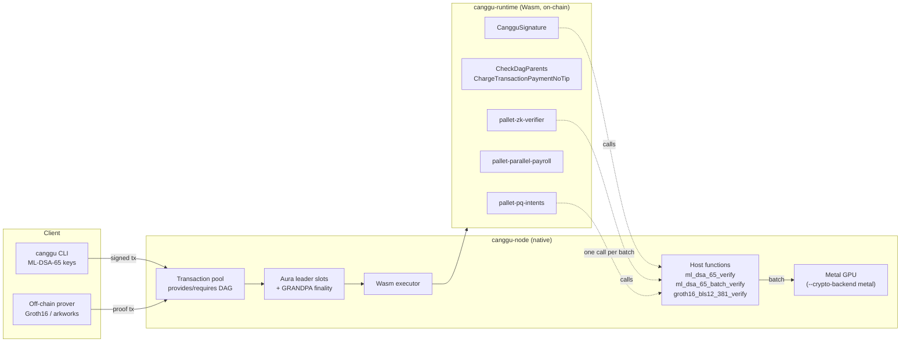

## :warning: :construction: For learning only. Use at your own peril. :construction: :warning:

This is a research prototype that explores how far the Polkadot SDK can go. It is not audited and
it is not production software. Do not use it, or its development keys, to hold or move real value.

# Canggu on the Polkadot SDK

> 📖 **Read the book:** [agustinustheodorus.com/canggu-blockchain](https://agustinustheodorus.com/canggu-blockchain/),
> a beginner-friendly guide to everything in this repository (source in [`docs/`](docs/)).

**How far can the Polkadot SDK be pushed?** This repository rebuilds *Canggu*, a quantum-secure,
MEV-resistant, GPU-parallel blockchain designed by the Bitwyre team, on top of the
[Polkadot SDK](https://github.com/paritytech/polkadot-sdk) (`polkadot-stable2609`).

It is an experiment, not an endorsement. The goal is to take an ambitious design and see which parts
map cleanly onto Substrate/FRAME, which need new primitives, and where the hard limits are,
including whether a Polkadot SDK node can put real work on a GPU. **It can:** blocks containing
hundreds of post-quantum signatures are verified on an Apple M4 Pro GPU through Metal, while a
second validator verifies the same blocks on its CPU, and the two stay in consensus
([details](#polkadot-sdk-on-a-gpu)).

> **Credits.** Canggu, its design and its original whitepaper are the work of
> **Dendi Suhubdy, Tejveer Singh, Mitul Dhawan and Maldini Sonkeng (Bitwyre)**. The original
> repository was set up by **Dendi Suhubdy** and **Mitul Dhawan** ([@mitul72](https://github.com/mitul72)),
> and its first commits are preserved in this repository's history. They open-sourced the project;
> this fork keeps their GPL-3.0 license. Everything built on top is an independent rebuild of their
> idea. Credit for the idea is theirs, and mistakes in the rebuild are ours.
>
> **Who wrote the rebuild.** The code, measurements, whitepaper v2.0 and documentation were written
> by **Claude**, an AI model made by Anthropic, in a conversation directed by
> [agustinustheo](https://github.com/agustinustheo), who chose the goals, reviewed the results and
> publishes them here. See [Credits and authorship](https://agustinustheodorus.com/canggu-blockchain/credits.html)
> for every library used.
>
> * Original whitepaper (v1.3): [`canggu-blockchain-whitepaper`](https://github.com/agustinustheo/canggu-blockchain-whitepaper)
> * Polkadot SDK edition of the whitepaper (v2.0), describing this code: [`v2/main.pdf`](https://github.com/agustinustheo/canggu-blockchain-whitepaper/blob/main/v2/main.pdf)

## What runs today

```
$ ./target/release/canggu demo
=== 1. Post-quantum accounts (ML-DSA-65 / CRYSTALS-Dilithium3) ===
  Alice -> Dave 100 CGU: 5345 byte extrinsic (1952-byte key + 3309-byte signature inside)
=== 2. DAG-ordered transactions (cross-account dependencies) ===
  submitting Charlie's tx FIRST; it declares Bob's tx (nonce 0) as parent
  2 blocks later the child is still not in any block: it waits for its parent
  parent: block #6 index 1 | child: block #6 index 2
=== 3. No priority auction: tips are rejected ===
  rejected by the pool as expected: Invalid Transaction: "Custom error: 0"
=== 4. Payroll: one debit, conflict-free parallel credits ===
  batch paying Bob twice: rejected with Payroll::DuplicateRecipient
=== 5. zk-SNARK: prove a private payroll off-chain, verify on-chain ===
  proof generated on CPU in 32.7ms: 192 bytes
  ok: the chain verified the payroll total without seeing any salary
  same proof, claimed total + 1: rejected with ZkVerifier::InvalidProof
=== 6. Post-quantum intents: one batch, one (GPU-accelerable) host call ===
  block #13: 62 intents executed, 2 rejected {"BadSignature": 2}
All Canggu features exercised successfully.
```

| Canggu idea (v1.3) | How it maps onto the Polkadot SDK | Status |
| --- | --- | --- |
| Dilithium signatures | New `CangguSignature::MlDsa65` account signature, verified by a native **host function** | ✅ |
| Quantum-resistant hashing | BLAKE2b-256 already gives 128-bit post-quantum preimage security | ✅ |
| DAG mempool | The transaction pool is *already* a tag DAG. `CheckDagParents` adds cross-account edges, enforced by consensus | ✅ |
| MEV mitigation | Dependency enforcement + **no tips** + **sealed order-then-reveal** ([from Rand](#lessons-from-rand-protocol-why-it-is-built-differently-and-what-we-took)) | 🟡 commit-reveal, not threshold encryption |
| Tower-BFT-style leader consensus | Aura (2 s round-robin leader slots) + GRANDPA finality | ✅ |
| Sub-second finality | Tuned GRANDPA: **242 ms** p50 on localhost ([measured](#sub-second-finality-how-far-can-grandpa-go)) | 🟡 not tested over a real network |
| ZK-SNARK verifiers / provers | Groth16 **and post-quantum SP1 STARKs**, each behind a host function; off-chain provers | ✅ |
| Signature compression | One SP1 proof replaces every key and signature of an intent batch ([SP1](#post-quantum-proofs-and-signature-compression-with-sp1)) | 🟡 works; pays off only above ~242 signatures |
| GPU acceleration | Batch ML-DSA verification on **Apple Metal**, behind a runtime host function | ✅ |
| Parallel CPU/GPU contracts | Conflict-free batch payroll; general GPU contracts are not deterministic | 🟡 |
| 50,000+ TPS | Measured: bandwidth-bound at ~370 PQ transfers/s | ❌ needs compression with GPU provers |

## Architecture



The core trick is to keep consensus logic in the Wasm runtime and move **heavy cryptography into
host functions**. A host function is a fixed bytes-in, bool-out contract that the node implements
natively. That is how Substrate verifies sr25519 today, and it is the one place where a node can
swap a CPU implementation for a GPU one without changing consensus.

## The pieces

### Post-quantum accounts: `primitives/`
* Accounts are `blake2_256(ml_dsa_public_key)`. A 1,952-byte key cannot be an `AccountId32`, so the
  signature carries the key and verification first checks that it hashes to the sender. This
  prevents key substitution and costs one hash.
* FIPS 204 context string `canggu/tx/v1` for domain separation, deterministic signing.
* Ed25519, Sr25519 and ECDSA stay as *transition-period* variants (same encoding indices as
  `MultiSignature`), so polkadot.js and subxt still work. A runtime upgrade can retire them.

### DAG-ordered transactions: `pallets/dag-ordering/`
* `CheckDagParents` lets a transaction declare up to 8 parents as `(account, nonce)`, including
  other accounts' transactions.
* Pending parents become `requires` tags with the exact encoding `frame_system::CheckNonce` uses
  for `provides`, so Substrate's existing ready/future queues do the topological ordering.
* The same check runs again when the block executes. A block that puts a child before its parent is
  **invalid**. The check runs *before* `CheckNonce`, so a rejected transaction mutates nothing.
* `ChargeTransactionPaymentNoTip` is the stock fee extension with tips rejected. Priority can no
  longer be bought.

### zk-SNARKs: `pallets/zk-verifier/`, `zk/`, `sp1/`
* Circuit-agnostic verifier pallet with two proof systems: Groth16/BLS12-381 (192-byte proofs, not
  post-quantum) and SP1 compressed STARKs (1.27 MB, post-quantum). Verified statements are recorded.
* Example *private payroll* circuit: prove that hidden 64-bit salaries sum to a public total and open
  a public MiMC commitment, without revealing any salary.

### Post-quantum intents: `pallets/pq-intents/`
* Users sign transfer *intents* off-chain. A relayer submits up to 640 of them in one extrinsic.
* The runtime verifies the whole batch with **one** host call, `ml_dsa_65_batch_verify`, which is the
  call a node can run on a GPU. Each intent then succeeds or is rejected on its own (bad signature,
  stale nonce, failed transfer).

### Sealed ordering: `pallets/sealed-ordering/`
* Commit a 32-byte hash, reveal later, execute in an order nobody chose. See
  [Lessons from Rand Protocol](#lessons-from-rand-protocol-why-it-is-built-differently-and-what-we-took).

### Parallel payroll: `pallets/parallel-payroll/`
* `batch_pay` debits the employer once, then credits distinct recipients. Distinctness is enforced,
  so the credits touch disjoint state and commute, which is the property a parallel executor needs.

## Numbers (Apple M4 Pro, release build)

| | |
| --- | --- |
| ML-DSA-65 verify (native host fn, 1 core) | **61 µs** |
| ML-DSA-65 batch verify on Metal, 4,096 sigs | **6.5 ms** (630k sig/s, 4.45× all 12 CPU cores) |
| ML-DSA-65 transfer extrinsic | **5,345 B** (vs ~150 B for sr25519) |
| Groth16 verify, payroll circuit (any size) | **2.3 ms**, 192 B proof |
| Groth16 prove, 1,024 salaries (405k constraints) | 2.0 s on 12 cores |
| Capacity with 5 MiB blocks / 2 s slots | ~370 PQ transfers/s, **bandwidth-bound** |

## What did not survive contact with the code

Building the design surfaced a few claims from v1.3 that don't hold. They're documented in the v2.0
whitepaper, and the most important ones are:

* **Kyber can't sign transactions.** It's a key-encapsulation mechanism. Accounts use ML-DSA, and
  ML-KEM is reserved for an encrypted mempool.
* **XMSS isn't a hash function.** It's a stateful signature scheme.
* **BLS12-381 SNARKs aren't quantum-resistant.** Shor's algorithm breaks pairings, and STARKs are
  the post-quantum path.
* **A DAG doesn't make MEV computationally hard.** Topological sorting is linear and any linear
  extension is valid. The DAG enforces the dependencies users *declare*. Front-running independent
  transactions needs order-then-reveal, which is now implemented as sealed ordering.
* **50k TPS with 3.3 kB signatures** would mean ~265 MB/s of gossip. That needs signature
  compression (a STARK over the block's signatures), which is where the GPU and ZK pillars meet.

## Polkadot SDK on a GPU?

The Wasm runtime itself can't sensibly run on a GPU. Every validator must compute bit-identical state
roots, execution must be metered, and GPU kernels can't touch the state trie. So this rebuild goes as
close to the GPU as the Polkadot SDK allows: **the runtime stays deterministic Wasm, and makes one
host call per batch that the node executes on the GPU.**

```
runtime (Wasm)  pallet-pq-intents::submit_intents(640 signed intents)
      │  canggu_crypto::ml_dsa_65_batch_verify(batch)          ← one host call
node (native)   accel backend chosen with --crypto-backend
      ├─ cpu            reference implementation, 1 core      ← defines the correct answer
      ├─ cpu-parallel   reference implementation, all cores   (default)
      └─ metal          gpu/: FIPS 204 Verify as Metal compute kernels
                          CPU: decode, hint/z checks, tr, μ, challenge
                          GPU: NTTs → ExpandA × z → UseHint/w1Encode → SHAKE256 compare
```

### Proof that it runs on the GPU

**1. A live chain, verifying on Metal.** `canggu-node --dev --crypto-backend metal`, then
`canggu intents --count 640 --forge 4`:

```
⚡ ML-DSA-65 batch verification backend: Metal (Apple M4 Pro), batches of 64+ signatures
⚡ Metal (Apple M4 Pro): batch-verified 640 ML-DSA-65 signatures (636 valid) in 8.36ms (GPU busy 4.12ms over 1 command buffer(s), CPU prep 968.21µs)
⚡ Metal (Apple M4 Pro): batch-verified 256 ML-DSA-65 signatures (252 valid) in 5.24ms (GPU busy 1.66ms over 1 command buffer(s), CPU prep 652.50µs)
⚡ CPU (12 cores): batch-verified 32 ML-DSA-65 signatures (28 valid) in 749.13µs (below --metal-min-batch 64)
```

"GPU busy" is measured by Metal itself (`MTLCommandBuffer` `GPUStartTime`/`GPUEndTime`). The four
forged intents in each batch were rejected on the GPU.

**2. Consensus across different hardware.** [`scripts/mixed-backends.sh`](scripts/mixed-backends.sh)
runs two validators: Alice verifies on Metal, Bob on one CPU core. Aura alternates authors, so every
batch is verified by the GPU on one validator and by the CPU on the other. Had they disagreed on a
single signature, the importing node would compute a different state root and reject the block.

```
#6:  authored by Alice (metal), imported by Bob (cpu)
#7:  authored by Bob (cpu), imported by Alice (metal)
#8:  authored by Alice (metal), imported by Bob (cpu)
#9:  authored by Bob (cpu), imported by Alice (metal)
#10: authored by Alice (metal), imported by Bob (cpu)
#11: authored by Bob (cpu), imported by Alice (metal)
blocks 1..11: identical
finalized: alice #11, bob #11
```

**3. Bit-exactness tests.** `cargo test --release -p canggu-gpu` checks the Metal kernels, a
pure-Rust mirror of each kernel, and the RustCrypto `ml-dsa` crate against each other on 5,454 items:
2,504 valid signatures, and 2,950 corrupted ones (bit flips in every field, malformed hints, z at the
bound, wrong contexts and lengths). All three agree on every item. A GPU self-test, which also runs
at node start-up, checks UseHint for **every** value below q, the modular arithmetic and Keccak-f
against the CPU. It caught a planted off-by-one that real signatures never exercise.

**4. Throughput** (`cargo run --release --bin bench`, Apple M4 Pro, medians; wall time includes CPU
pre-processing and transfers):

| batch | ml-dsa, 1 core | ml-dsa, 12 cores | Metal | GPU busy | Metal vs 12 cores |
| ---: | ---: | ---: | ---: | ---: | ---: |
| 1 | 0.060 ms | 0.060 ms | 0.330 ms | 0.203 ms | 0.18× |
| 64 | 3.77 ms | 0.61 ms | 0.45 ms | 0.23 ms | 1.35× |
| 256 | 15.2 ms | 1.95 ms | 0.85 ms | 0.43 ms | 2.29× |
| 1024 | 61.2 ms | 7.52 ms | 2.12 ms | 1.50 ms | 3.55× |
| 4096 | 246 ms | 29.0 ms | 6.51 ms | 5.59 ms | **4.45×** (630k sig/s) |

Honest caveats:

* Below ~64 signatures the fixed ~0.2 ms GPU submission cost loses to the CPU, so the node routes
  small batches to the CPU.
* In the live node, a batch costs more than in the warm benchmark. The node also copies the batch
  across the host-function boundary, and on this machine macOS's photo-analysis service was keeping
  the GPU busy at the same time.
* Weights are still charged at single-core CPU cost, because every validator must be able to keep
  up, GPU or not.
* Only Apple Metal is implemented. A CUDA backend would slot in behind the same trait, with the same
  differential tests.

Why signatures? ML-DSA verification is mostly SHAKE128 matrix expansion and number-theoretic
transforms: integer-only, embarrassingly parallel, and exactly what makes post-quantum accounts
expensive. That makes it the GPU workload that matters most for this design.

## Post-quantum proofs and signature compression with SP1

Two gaps were left: the ZK pillar used Groth16 (pairings, broken by Shor's algorithm), and nothing
compressed the 5.3 kB of key and signature every post-quantum transaction carries.
[SP1](https://github.com/succinctlabs/sp1) v6.10 closes both. It proves ordinary Rust programs
(compiled to RISC-V) into **compressed proofs**: hash-based STARKs with no elliptic curves. The node
verifies them with one more host function, `sp1_v6_verify_compressed`. The programs, prover and
measurements live in [`sp1/`](sp1/README.md).

* **Post-quantum ZK.** `sp1/programs/payroll` proves the payroll statement (private salaries sum
  to a public total and open a commitment). `pallet-zk-verifier::submit_sp1_proof` accepts it next
  to the old Groth16 path.
* **Signature compression.** `sp1/programs/mldsa-batch` runs ML-DSA-65 verification inside SP1,
  bit-exact with the `ml-dsa` crate, with Keccak on SP1's precompile. It commits a digest of
  `(sender, keccak(payload))` pairs. `pallet-pq-intents::submit_compressed` then takes a batch with
  **no keys and no signatures**, rebuilds that digest from the intents and the genesis hash, and
  checks the one proof.

```
$ canggu zk-sp1 --from //Alice --salt "october payroll" --amounts 3000,4500,1250,8000,2200
payroll proved: 6137 cycles, 1272546 byte proof, 59.2 s
  submitting a 1.28 MB post-quantum proof
  ok: the chain verified that 5 private salaries sum to 18950

$ canggu intents --count 8 --senders 4 --compressed
mldsa-batch proved: 5611080 cycles, 1272546 byte proof, 112.7 s
  relayer submits 1.28 MB (one SP1 proof, no keys or signatures) instead of 0.04 MB
  block #91: 8 intents executed, 0 rejected {}

node: 🔐 SP1 compressed proof (1272546 bytes): valid in 41.95ms
```

The numbers are the research result (Apple M4 Pro, CPU prover):

| | |
| --- | --- |
| Proof size | 1,272,546 B, whatever the program or batch size |
| Verification | 25.5 ms natively, ~40 ms through the node's host function |
| ML-DSA-65 inside SP1 | 700k cycles per signature with the Keccak precompile (1.8 M without) |
| Proving `mldsa-batch` | ~9.4 s per signature: 4 sigs 72 s, 64 sigs 617 s, 128 sigs 1,219 s |
| Break-even | **≈ 242 signatures** per proof, about 37 minutes to prove on this laptop |

So signature compression **works end to end but doesn't pay on a laptop**. The 8-intent demo batch
is 30× *bigger* than the signatures it replaces. It needs GPU provers (SP1's is CUDA-only) and
batches of hundreds of signatures, which is exactly why Rand Protocol pipelines aggregation through
a GPU market. Two more findings:

* **Proof malleability.** The raw `sp1-verifier` accepts several byte strings for one valid proof
  (trailing bytes, field elements ≥ p). Canggu's wrapper requires the canonical encoding, and a test
  shows the difference.
* **Not runtime-ready.** The verifier doesn't build for `wasm32v1-none`, the polkadot-sdk runtime
  target, which is why it sits behind a host function.

## Sub-second finality: how far can GRANDPA go?

Canggu v1.3 asks for "sub-second finality". Substrate's defaults finalize about 5 seconds after a
block appears, which makes it look like GRANDPA can't get there. Measuring showed the latency
comes almost entirely from two conservative defaults, not from the protocol:

* **Vote lag.** Substrate's voting rule `BeforeBestBlockBy(2)` makes validators vote for a block
  two behind the best one, a margin against voting for a fork that is about to be abandoned. At
  2 s blocks that is 4 s on its own. Lowering it doesn't weaken safety: a block is final only
  with 2/3 precommits, and votes on a losing fork simply finalize the common ancestor.
* **Gossip duration.** A GRANDPA voter waits up to 2× this before prevoting and 4× before
  precommitting. The default is 333 ms.

Both are now node flags (`--grandpa-vote-lag`, `--grandpa-gossip-ms`), and the slot length is a
compile-time knob (`CANGGU_SLOT_MS`). `scripts/finality.sh` runs two validators and measures the
time from each block's first appearance to its finalization:

| slot | gossip | vote lag | time to finality p50 | p90 |
| ---: | ---: | ---: | ---: | ---: |
| 2 s | 333 ms | 2 (Substrate default) | 5 s | 6 s |
| 2 s | 333 ms | 0 | 1 s | 2 s |
| 2 s | 100 ms | 0 | 430 ms | 584 ms |
| 2 s | 50 ms | 0 | **242 ms** | 288 ms |
| 500 ms | 333 ms | 2 | 2 s | 3 s |
| 500 ms | 50 ms | 0 | **217 ms** | 293 ms |
| 500 ms | 25 ms | 0 | **121 ms** | 173 ms |

These are **localhost** numbers: the protocol's floor, measured while other builds were loading
the machine. Real validators add network latency to every round. The gossip duration has to
exceed it, and each GRANDPA round needs about two message delays (prevote, precommit). A
validator set with 50–100 ms between members should land well under a second. A global set with
200 ms+ round trips probably won't. Nothing here was tested over a real network, and the shipped
defaults stay at Substrate's conservative values.

```bash
GOSSIP_MS=50 VOTE_LAG=0 scripts/finality.sh 40                 # 2 s slots
CANGGU_SLOT_MS=500 cargo build --release -p canggu-node &&
  CANGGU_SLOT_MS=500 GOSSIP_MS=50 VOTE_LAG=0 scripts/finality.sh 30
```

## Lessons from Rand Protocol: why it is built differently, and what we took

[Rand Protocol](https://github.com/randprotocol/fullnode) ([whitepaper](http://randprotocol.org/papers/randprotocol.pdf))
is a later chain by Dendi Suhubdy, one of Canggu's original authors; its whitepaper is by Dendi
Suhubdy and Anish Mohammed. It makes many of the same
choices (Dilithium, STARKs, GPU provers) on a different foundation. The differences come from one
decision: Rand is a **fully shielded chain**, with no accounts, no balances and no visible senders.
Canggu, like every Polkadot SDK chain, is an **account chain**.

| | Rand Protocol | Canggu on the Polkadot SDK | Why they differ |
| --- | --- | --- | --- |
| **Authorizing a transfer** | No signature. A STARK proves "I own these notes" (spend authority is inside the proof). | An ML-DSA-65 signature per transaction. | A signature names its signer and links its transactions, which a privacy chain can't allow. An account chain has public senders anyway, and a signature is about 250× smaller and about 130,000× faster to produce (5.3 kB in 0.75 ms, against ~1.3 MB in ~100 s). |
| **Cost per transfer** | ~1.3 MB, about 3 transfers per 4 MiB block | 5.3 kB, about 740 per block | Rand pays for privacy and for 80-query STARK soundness in bytes. |
| **What gets "compressed"** | Proofs: GPU aggregators prove one recursive STARK over a window of *finalized* blocks ("sealing"), after which the inner proofs can be dropped. | Signatures, per intent batch, with one SP1 proof. | At 1.3 MB per transfer Rand *must* aggregate. At 5.3 kB Canggu only benefits above ~300 signatures per proof (a production proof is ~1.3–1.6 MB). |
| **Old history** | Rejected pruning: a syncing node would have to trust old finality signatures, which opens long-range attacks on a proof-carrying chain. | Substrate already trusts GRANDPA justifications for warp sync, so `--blocks-pruning` is consistent with its trust model. | Different trust models. Canggu's *storage* problem is solved by an existing node flag; its *bandwidth* problem is not. |
| **Where the GPU sits** | Off the critical path: a permissionless aggregator market. Validators stay CPU-only. | Behind a host function on validators (optional), plus a CPU reference. | Both keep GPUs out of consensus requirements. Rand pays GPU owners for proofs; Canggu lets a validator use one to keep up. |
| **Consensus signatures** | Chained HotStuff with **Dilithium2** votes: post-quantum end to end. | Aura (sr25519) + GRANDPA (ed25519): classical. | Rand wrote its own consensus. In Substrate, post-quantum session keys mean changing the keystore and the GRANDPA vote format. |
| **Proof system** | Plonky3 STARKs (Goldilocks, Poseidon2, FRI): post-quantum and transparent | Groth16 / BLS12-381, plus SP1 STARKs (KoalaBear, Poseidon2, FRI) | Both chains end up on hash-based STARKs of ~1.3 MB. |
| **Front-running** | Content privacy, but the leader still orders a plaintext mempool by fee then hash. The paper retracts "privacy eliminates front-running" (Prop. 14.2) and proves it only under three conditions (Thm. 15.4), which the live chain does not implement. | DAG dependencies, no tips, and now **sealed ordering**. | The theorem is the useful part, and it transfers to an account chain. |

### What we took: sealed (order-then-reveal) ordering, `pallets/sealed-ordering/`

Rand's Theorem 15.4 says front-running is eliminated only if (1) the order is fixed while contents
are hidden, (2) there is exactly one valid order, and (3) what is visible before ordering doesn't
distinguish transactions. Rand meets (1) with threshold encryption, which today is pairing-based
and not post-quantum. Canggu uses hash commitments instead:

1. **Commit** (block `N`): anyone, typically a relayer, posts `blake2_256(sender, call, salt)` with a
   deposit. Every commitment is an opaque 32-byte hash, and with a relayer the sender is hidden too.
2. **Reveal** (blocks `N+1..N+2`): the sender posts `(call, salt)`. The commitment binds the sender,
   so nobody else can reveal or copy it.
3. **Execute** (start of block `N+3`): every revealed call of block `N` runs in the order
   `blake2_256(commitment ‖ hash of block N)`. Nobody chose this order, and it can't be computed at
   commit time. A front-runner who reacts to a reveal can only commit in a later block, which
   executes after.

```
$ canggu sealed
  relayer committed 4 opaque 32-byte hashes in block(s) {3}: nobody can tell who pays whom
  Dave revealed in block #4 (index 1)
  Charlie revealed in block #4 (index 2)
  Bob revealed in block #4 (index 3)
  block #6: position 0: Bob (ok)
  block #6: position 1: Dave (ok)
  block #6: position 2: Charlie (ok)
  block #6: Eve never revealed, deposit burned
  ok: execution order = blake2(commitment ‖ commit-block hash), not reveal order
```

What commit-reveal concedes compared with threshold encryption:

* A sender can decline to reveal (a "free option"). The deposit prices it.
* A leader could censor reveals.
* The leader of block `N` can nudge block `N`'s hash, though that only reshuffles commitments nobody
  can read.
* Back-running (acting *after* a revealed transaction) is not prevented.

### What we took later: signature compression, without the market

Rand's design gives the architecture: pipelined sealing over finalized blocks, a permissionless GPU
aggregator market, "most coverage wins", and proofs bound to the aggregator's identity. It also
gives the price. Rand measured 26 minutes to prove an aggregate of a single transfer (test
profile, on a loaded shared machine) and ≥ 512 GB of host memory for a production one. Canggu now
has the core of it, an SP1 proof that replaces a batch's signatures ([above](#post-quantum-proofs-and-signature-compression-with-sp1)),
and measured the same lesson: a laptop CPU needs ~37 minutes to reach the ~242-signature
break-even. The windowed, pipelined aggregator market is what would make it pay. It isn't built.

### Is `paritytech/verifiable` useful here?

[`verifiable`](https://github.com/paritytech/verifiable) proves *membership in a set without
revealing which member*. It uses ring VRFs on Bandersnatch (BLS12-381), with 752-byte proofs, one
unlinkable 32-byte alias per member per context, and batch verification. For Canggu:

* **Useful for front-running metadata.** A sealed commitment could carry a ring proof that it came
  from some registered account, with one alias per epoch as a rate limit, instead of going through a
  relayer. That's a stronger version of condition (3).
* **Not useful for signature compression.** It provides anonymity, not aggregation. A ring proof
  (752 B) is larger than a plain signature, and proofs don't combine into one.
* **Not post-quantum.** Like Groth16, its security rests on elliptic curves. Its *trait*
  (`GenerateVerifiable`: members, proofs, aliases) is crypto-agnostic, though, and could front a
  post-quantum implementation, e.g. a STARK over a Poseidon2 Merkle tree with nullifiers, which is
  how Rand's shielded pool works.

## Quick start

```bash
cargo build --release                       # node + CLI (~10 min cold)
./target/release/canggu-node --dev --tmp    # 2 s blocks, RPC on 127.0.0.1:9944
                                            # add --crypto-backend metal on Apple silicon
./target/release/canggu demo                # in another terminal
```

Requirements: Rust 1.93 (pinned by `rust-toolchain.toml`), `protoc`, clang. A `Dockerfile` based on
Parity's CI image is included but has not been tested yet.

### CLI

Dev keys are ML-DSA-65 keys derived from `//Alice` … `//Eve`, all pre-funded on the dev chain.

```bash
canggu account //Alice
canggu balance //Eve
canggu transfer --from //Dave --to //Eve --amount 1.5 --after //Bob:0   # only after Bob's nonce-0 tx
canggu payroll  --from //Alice --pay //Bob=10 --pay //Charlie=20
canggu zk-setup --recipients 3        # single-party setup: demo only
canggu zk-register --from //Bob
canggu zk-prove --salt 7 --amounts 100,200,300
canggu zk-submit --from //Bob
canggu intents --count 640 --forge 4  # one batch of PQ-signed intents (GPU with --crypto-backend metal)
canggu sealed                         # commit, reveal out of order, canonical execution
canggu finality --seconds 40          # time from a block's appearance to its finalization
canggu zk-sp1 --from //Alice --salt s --amounts 3000,4500   # post-quantum payroll proof (SP1)
canggu intents --count 8 --compressed # one SP1 proof instead of 8 keys + signatures
canggu bench                          # native crypto benchmarks, no node needed
```

### Tests

```bash
cargo test --release --workspace
```

66 tests (plus the `sp1/` workspace's own). They include real SP1 proofs, the GPU differential
tests above, and the sealed-ordering tests (canonical order
independent of inclusion and reveal order, front-runners executing after their victims), the runtime integration tests
(`runtime/tests/extrinsics.rs`) push real ML-DSA-signed extrinsics
through `Executive`. They cover valid transfers, bit-flipped and key-substituted signatures
(`BadProof`), a DAG child before its parent (`Future`), and tips (rejected).

## Repository layout

| Path | Crate | Role |
| --- | --- | --- |
| `primitives/` | `canggu-primitives` | `CangguSignature`, host functions, dev keyring |
| `pallets/dag-ordering/` | `canggu-dag-ordering` | `CheckDagParents`, `ChargeTransactionPaymentNoTip` |
| `pallets/zk-verifier/` | `pallet-zk-verifier` | Groth16 verifying keys and proofs |
| `pallets/parallel-payroll/` | `pallet-parallel-payroll` | Conflict-free batch payments |
| `pallets/pq-intents/` | `pallet-pq-intents` | Batches of ML-DSA-signed intents, one batch host call |
| `pallets/sealed-ordering/` | `pallet-sealed-ordering` | Order-then-reveal commitments with canonical execution order |
| `gpu/` | `canggu-gpu` | ML-DSA-65 batch verification on Apple Metal, CPU mirror, differential tests |
| `gpu/bench/` | `canggu-gpu-bench` | Metal vs CPU benchmark |
| `scripts/` | | `mixed-backends.sh`: GPU vs CPU validators; `finality.sh`: time to finality |
| `sp1/` | separate workspace | SP1 programs (`mldsa-batch`, `payroll`), `canggu-sp1` prover, `canggu-sp1-verify` |
| `zk/` | `canggu-zk` | Private payroll circuit, setup, proving |
| `runtime/` | `canggu-runtime` | FRAME runtime |
| `node/` | `canggu-node` | Aura + GRANDPA node with Canggu host functions |
| `cli/` | `canggu-cli` | `canggu` wallet, prover, demo, benchmarks |

## Limitations

This is a research prototype:

* Only *account* signatures and SP1 proofs are post-quantum. Aura/GRANDPA session keys, the p2p
  handshake and the Groth16 path are still classical.
* Weights are hand-set rather than benchmarked. The trusted setup is single-party and the circuit is
  unaudited.
* Front-running protection is commit-reveal, not threshold encryption: senders can decline to
  reveal (and lose the deposit), and back-running is not prevented.
* Signature compression is per batch and proven on a CPU, so it is a net loss below ~242 signatures.
  There is no GPU prover market or windowed aggregation.

See [TODO.md](TODO.md) for the roadmap.

## References and credits

* **Canggu** design and whitepaper v1.3: Dendi Suhubdy, Tejveer Singh, Mitul Dhawan, Maldini Sonkeng
  (Bitwyre). Original repository: Dendi Suhubdy and Mitul Dhawan.
* **Rand Protocol**: [full node](https://github.com/randprotocol/fullnode) by Dendi Suhubdy, and
  [whitepaper](http://randprotocol.org/papers/randprotocol.pdf) by Dendi Suhubdy (Bitwyre) and Anish
  Mohammed (Zeroknowledge Consulting Ltd). Sealed ordering adapts its
  Theorem 15.4 and Proposition 14.2. The aggregation analysis follows its `docs/aggregation.md` and
  `docs/block-space.md`.
* **[Polkadot SDK](https://github.com/paritytech/polkadot-sdk)** and
  **[`verifiable`](https://github.com/paritytech/verifiable)**: Parity Technologies.
* **[SP1](https://github.com/succinctlabs/sp1)**: Succinct Labs, for post-quantum proofs and
  signature compression.
* **[`ml-dsa`](https://crates.io/crates/ml-dsa)**: RustCrypto. **[arkworks](https://arkworks.rs)**
  for Groth16. **[`objc2-metal`](https://github.com/madsmtm/objc2)** for the Metal bindings.
* **The rebuild:** written by Claude (Anthropic), directed and published by agustinustheo. The full
  list is in the book's [Credits and authorship](https://agustinustheodorus.com/canggu-blockchain/credits.html).

## License

GPL-3.0, as chosen by the original authors. See [LICENSE](LICENSE).
